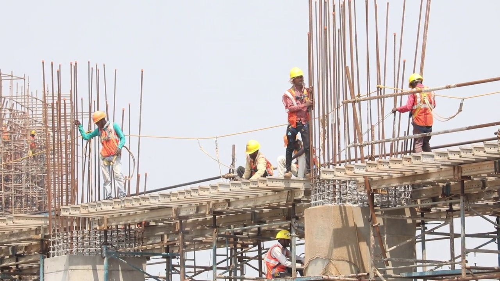

# PPE Detection & Worker Tracking

A video-based **Personal Protective Equipment (PPE) compliance system**. It tracks every person in a video, checks whether they are wearing a **helmet** and a **safety vest**, and automatically logs violations with timestamps and screenshots.



## Features

- **Person detection & tracking** with YOLOv8 (COCO) + **ByteTrack**, so each worker keeps a unique ID even through short occlusions
- **Custom-trained PPE model** (YOLOv8) with 5 classes: `helmet`, `no_helmet`, `vest`, `no_vest`, `person`
- **PPE-to-person matching** by checking whether each equipment box's center falls inside the person's upper-body region
- **False-positive filtering**: a violation is recorded only if equipment is missing for **15 consecutive frames** (configurable)
- **Violation logging** to `outputs/violations.json`, with a cropped screenshot of the person for each event
- Annotated output video with per-person status and an info panel

## How it works

```
Video frame ──► Person tracker (YOLOv8 + ByteTrack) ──► person boxes + IDs
           └──► PPE detector (custom YOLOv8)        ──► helmet / vest boxes
                                │
                Match PPE to each person's upper body
                                │
          Missing for N frames in a row? ──► log violation + screenshot
```

## Project structure

```
ppe-detection/
├── main.py                  # entry point
├── train.py                 # trains the PPE model
├── data.yaml                # dataset config (5 classes)
├── detectors/               # person & PPE detectors
├── tracking/                # ByteTrack-based person tracker
├── services/                # video I/O and violation logging
└── utils/                   # geometry & drawing helpers
```

## Installation

```bash
git clone https://github.com/hamdigurel/ppe-detection.git
cd ppe-detection
pip install -r requirements.txt
```

## Usage

**Train the PPE model** (dataset prepared with Roboflow in YOLO format):

```bash
python train.py
```

**Run on a video:**

```bash
python main.py --video test_video.mp4
```

Results are saved under `outputs/`.

## Tech stack

Python · Ultralytics YOLOv8 · ByteTrack · OpenCV · NumPy · Roboflow

## Dataset

Annotated and exported with [Roboflow](https://universe.roboflow.com/hamdi-gurel/human-head-bxqso-15y7u) (CC BY 4.0).
